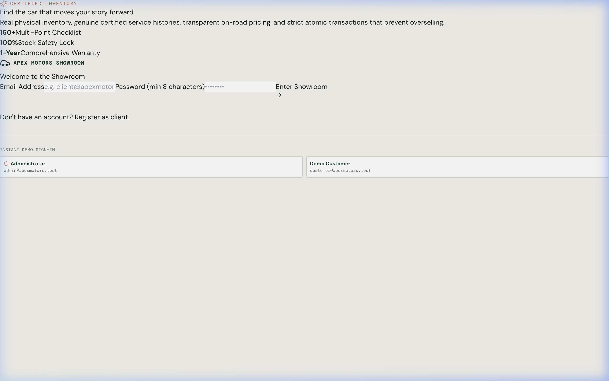
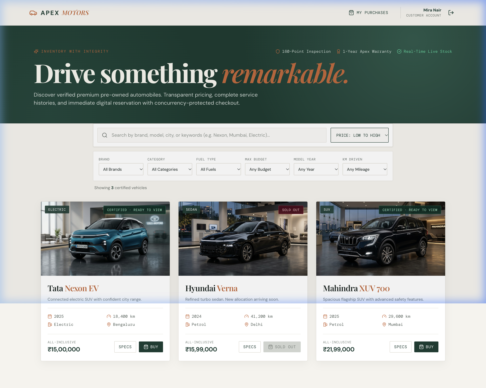
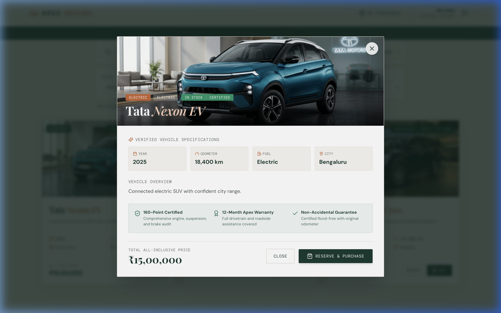
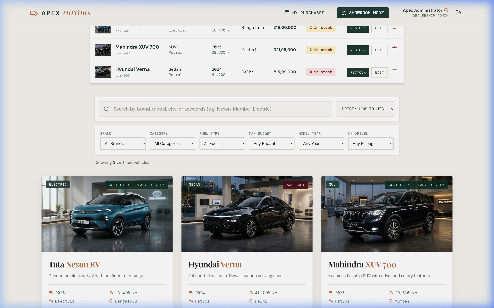
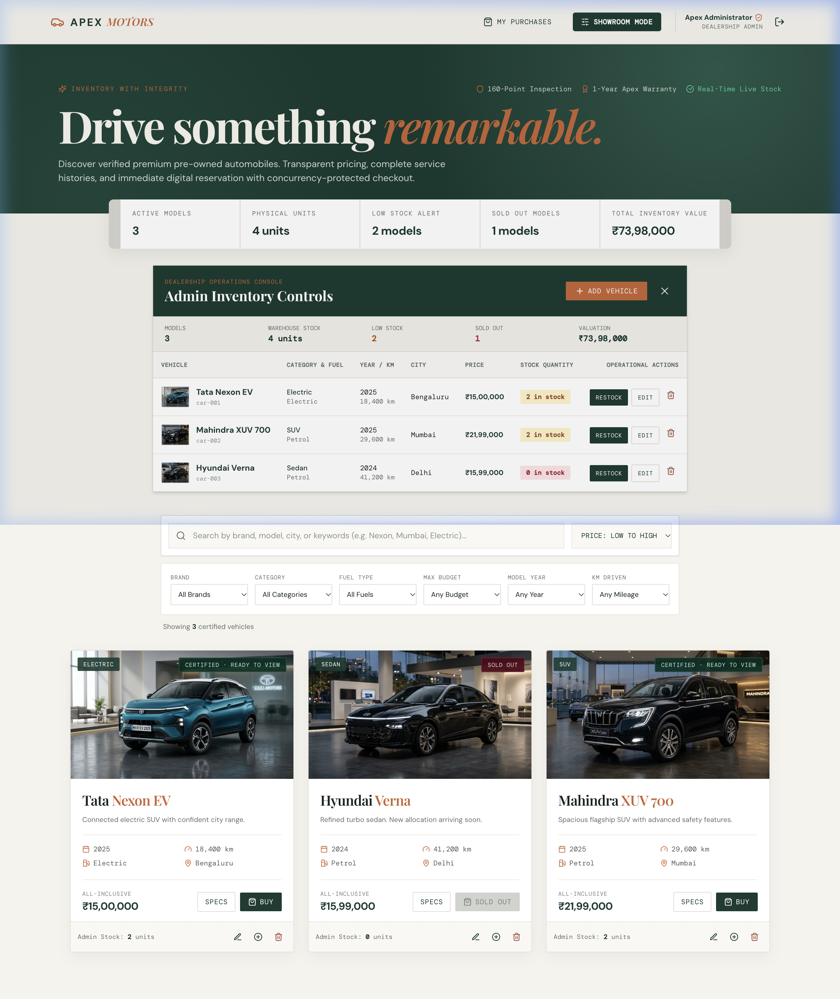
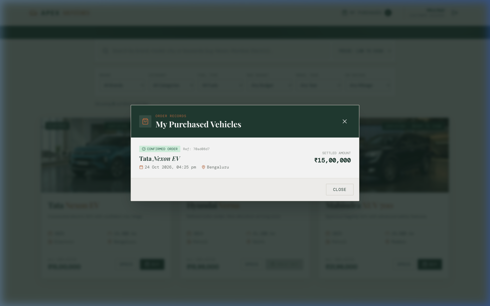

# Apex Motors - Premium Used-Car Dealership & Inventory System

A luxury pre-owned automotive dealership platform engineered for the TDD Kata. Customers browse a showroom catalogue with verified vehicle metadata, dynamic facet filters, instant specification modals, and concurrency-protected atomic checkout. Dealership administrators manage operational stock, monitor warehouse health, and adjust inventory with strict role authorization.

---

## Visual Showroom & Interface Highlights

### 1. Client Authentication & Instant Demo Access


### 2. Luxury Customer Showroom with Rich Facet Filters


### 3. Detailed Vehicle Specification & Inspection Modal


### 4. Concurrency & Oversell Protection: Sold-Out State


### 5. Dealership Operations Console & Health Metrics (Admin Only)


### 6. Customer Purchase & Delivery Tracking


---

## Architectural & Data Model Upgrades

### 1. Persistent Vehicle Metadata & Safe Migrations
- Added persistent `kms_driven`, `fuel_type`, and `city` fields to the vehicle schema alongside model `year`, `category`, `price`, `quantity`, and `description`.
- Implemented safe database migrations via idempotent SQLite `ALTER TABLE` statements wrapped in exception handlers, ensuring existing databases upgrade seamlessly without data loss.

### 2. Customer Privacy & Warehouse Segregation
- **Buyer Showroom View**: Regular customers see buyer-facing availability statuses (`Certified · Ready to View` or `Sold Out`) without exposing internal warehouse quantities (e.g. `4 in stock`) or dealership financial valuations.
- **Admin Operations Console**: Total units, individual model quantities, low-stock warnings, and financial valuations are strictly protected behind admin authorization (`GET /api/dashboard`).

### 3. Comprehensive Showroom Experience
- **Dynamic Multi-Facet Filtering**: Filter by brand, fuel type (Petrol, Diesel, Electric, Hybrid), maximum budget, category (SUV, Sedan, Electric, Hatchback), model year, and mileage limits.
- **Buyer Card Metadata**: Every vehicle card displays the registration year, kilometres driven, fuel type, city location, all-inclusive price, and brand-correct imagery.
- **Interactive Modal**: Full specification matrix, 160-point quality certification perks, and one-click purchase reservation without leaving the showroom page.
- **Customer Purchase History**: Logged-in customers can inspect their order history and transaction receipts via the `My Purchases` modal (`GET /api/purchases/me`).

---

## Tech Stack

- **Frontend**: React 18, TypeScript, Tailwind CSS, Vite, Lucide Icons
- **Backend API**: Node.js, Express, TypeScript, SQLite (`better-sqlite3`)
- **Security**: JWT bearer token authentication, bcrypt password hashing (10 salt rounds), role-based access control (RBAC)
- **Testing**: Vitest, Supertest, React Testing Library, `@testing-library/jest-dom`

---

## Quickstart & Local Setup

### Prerequisites
- Node.js (v18 or higher)
- npm (v9 or higher)

### Installation

```bash
git clone <repo-url>
cd "Apex motors"
npm install
```

### Running Locally

```bash
npm run dev
```

- **Frontend Application**: `http://localhost:5173`
- **Backend REST API**: `http://localhost:4000`

### Pre-Configured Demo Accounts

| Role | Email | Password | Permissions |
| :--- | :--- | :--- | :--- |
| **Administrator** | `admin@apexmotors.test` | `Admin123!` | Full inventory management, warehouse metrics, restock, edit, delete |
| **Customer** | `customer@apexmotors.test` | `Customer123!` | Showroom browsing, search/filter, vehicle detail modal, purchase, purchase history |

*Note: The login screen also features 1-click demo sign-in buttons for instant evaluation.*

---

## REST API Specification

| Domain | Method & Path | Access | Description |
| :--- | :--- | :--- | :--- |
| **Auth** | `POST /api/auth/register` | Public | Register client account and receive JWT |
| **Auth** | `POST /api/auth/login` | Public | Authenticate user and receive JWT |
| **Catalogue** | `GET /api/vehicles` | Bearer Token | Retrieve all available vehicles |
| **Catalogue** | `GET /api/vehicles/search` | Bearer Token | Search by keyword, brand, category, fuel, price, year, KM |
| **Admin** | `POST /api/vehicles` | Admin Bearer | Add new vehicle with complete specifications |
| **Admin** | `PUT /api/vehicles/:id` | Admin Bearer | Update vehicle price, mileage, city, or specifications |
| **Admin** | `DELETE /api/vehicles/:id` | Admin Bearer | Permanently delete vehicle from inventory |
| **Admin** | `POST /api/vehicles/:id/restock` | Admin Bearer | Increment vehicle inventory stock |
| **Admin** | `GET /api/dashboard` | Admin Bearer | Internal warehouse metrics, risk indicators, inventory value |
| **Transactions** | `POST /api/vehicles/:id/purchase` | Bearer Token | Atomic purchase transaction (prevents overselling) |
| **Transactions** | `GET /api/purchases/me` | Bearer Token | Customer's order and purchase records |

---

## Test-Driven Development (TDD) & Quality Assurance

The system is tested using Vitest and Supertest across both the backend and frontend workspaces.

```bash
# Run all automated tests (backend + frontend)
npm test

# Run backend API tests only
npm run test --workspace=backend

# Run frontend React tests only
npm run test --workspace=frontend

# Validate production TypeScript build
npm run build
```

**Verified Test Results: 22 tests passing across 2 test suites (100% pass rate).** Detailed test output is documented in [TEST_REPORT.md](TEST_REPORT.md).

---

## Inventory Integrity & Oversell Prevention

A central business requirement is that physical vehicle inventory can **never be oversold**. 

In `backend/src/app.ts`, purchases execute inside a synchronized SQLite transaction:
```typescript
const purchase = db.transaction(() => {
  const updateResult = db
    .prepare('UPDATE vehicles SET quantity = quantity - 1 WHERE id = ? AND quantity > 0')
    .run(req.params.id);

  if (!updateResult.changes) {
    return null; // Sold out or out-of-stock
  }

  const vehicle = db.prepare('SELECT * FROM vehicles WHERE id = ?').get(req.params.id);
  db.prepare(`
    INSERT INTO purchases (id, user_id, vehicle_id, price)
    VALUES (?, ?, ?, ?)
  `).run(randomUUID(), req.user.sub, vehicle.id, vehicle.price);

  return vehicle;
})();
```

If another customer purchases the final unit in stock, the subsequent purchase attempt immediately returns `HTTP 409 Conflict` (`{ "message": "Vehicle is unavailable" }`), strictly guaranteeing that warehouse inventory never drops below zero.

---

## My AI Usage

In compliance with the assignment technical guidelines, modern AI pair-programming tools were utilized throughout the project lifecycle:

- **AI Tools Used**: Google DeepMind Antigravity AI, OpenAI Codex, and Gemini 3.8.
- **Workflow & Applications**:
  - *Data Modeling & Schema Migration*: Structured the schema extension for `kms_driven`, `fuel_type`, and `city` with defensive SQLite migrations.
  - *Test-Driven Development*: Generated test suites for search query matrices, atomic purchase boundaries, and React component rendering.
  - *Showroom Aesthetics & UI Architecture*: Designed the luxury colour palette (`#183c32` forest green, `#c96535` terracotta, `#f5f3ee` cream), responsive facet filters, interactive detail modal, and modular React components.
  - *Photorealistic Brand Imagery*: Generated brand-correct 4K commercial showroom photography for seeded vehicles (Tata Nexon EV, Mahindra XUV 700, Hyundai Verna).
- **Reflection on Impact**: AI acceleration reduced repetitive boilerplate creation, enabled rapid test-first iteration, and allowed focusing energy on transactional integrity, authorization boundary enforcement, and polished showroom user experience. All generated code and tests were manually reviewed, validated, and tested.
- **Conversation Logs**: Raw, unedited AI chat history and prompt records are maintained in [PROMPTS.md](PROMPTS.md).

---

## Interview Discussion Readiness

- **Authentication vs Authorization**: JWT authentication verifies client identity via cryptographic bearer tokens (`jsonwebtoken`). Authorization middleware (`admin`) validates the user's role claim (`role === 'admin'`) before allowing access to operational endpoints.
- **Password Security**: Passwords are never stored in plaintext. Passwords are salted and hashed using `bcryptjs` with 10 rounds of hashing.
- **Database Durability & Concurrency**: The SQLite engine is configured with `better-sqlite3` and foreign key enforcement enabled (`foreign_keys = ON`). Stock decrements use atomic `WHERE quantity > 0` conditions within ACID transactions to eliminate race conditions.
- **Data Model Migration**: Handled via idempotent `ALTER TABLE ... ADD COLUMN` statements with error suppression so existing databases migrate seamlessly.
